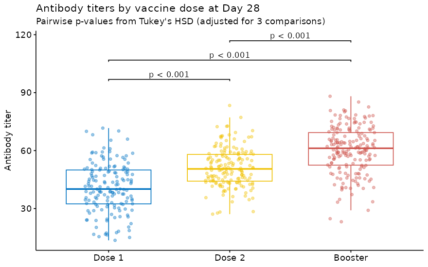
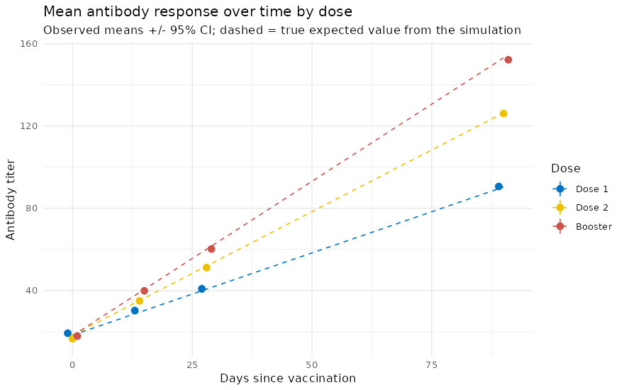

# Exploring Vaccine-Induced Immune Response (Simulated Data, R)

**Question:** if we simulate a three-arm vaccine study (Dose 1, Dose 2, Booster; antibody titers at Days 0, 14, 28 and 90), do standard methods (ANOVA, Tukey's HSD, logistic regression, a linear mixed model) recover the effects we built into the simulation?

**Answer:** mostly yes, and the places where they don't are the useful part. The dose slopes are recovered almost exactly, Tukey's 95% intervals cover all three true Day-28 differences, and the comorbidity penalty is recovered within its interval. One covariate with a true effect of zero (BMI) still comes out "significant", which is what you expect from testing eight coefficients at α = 0.05.

> **These are simulated data.** Every effect below was written into the simulation code, so nothing here is evidence about real vaccines. The project demonstrates a design-and-analysis workflow and checks it against a known truth.

Full rendered report: [`vaccine_response_analysis.html`](vaccine_response_analysis.html) (download and open in a browser). A companion Python version of the same simulation is at [lukahere007/vaccine-simulation-python](https://github.com/lukahere007/vaccine-simulation-python).

## Key results (seed 123, 500 simulated patients)

**Day 28, one row per patient.** One-way ANOVA: F(2, 497) = 114.4, p < 2e-16.

| Tukey comparison | True difference | Estimate | 95% CI |
|---|---|---|---|
| Dose 2 − Dose 1 | 11.2 | 10.3 | 7.2 to 13.4 |
| Booster − Dose 1 | 19.6 | 19.4 | 16.4 to 22.4 |
| Booster − Dose 2 | 8.4 | 9.0 | 6.1 to 12.0 |



**All timepoints, linear mixed model** (`nlme::lme`, random intercept per patient, 2,000 rows):

| Parameter | True value | Estimate | 95% CI | Covered? |
|---|---|---|---|---|
| Slope per day, Dose 1 | 0.8 | 0.804 | 0.783 to 0.825 | yes |
| Slope per day, Dose 2 | 1.2 | 1.193 | 1.172 to 1.213 | yes |
| Slope per day, Booster | 1.5 | 1.493 | 1.474 to 1.513 | yes |
| Any comorbidity | −3.5 (average) | −4.19 | −5.18 to −3.21 | yes |
| Age | 0 | 0.000 | −0.034 to 0.033 | yes |
| Sex (male) | 0 | 0.75 | −0.23 to 1.74 | yes |
| BMI | 0 | −0.126 | −0.247 to −0.005 | **no** (false positive) |



**Logistic regression for seropositivity (titer > 50) at Day 28:** odds ratios vs. Dose 1 are 3.4 (Dose 2) and 14.0 (Booster). All comorbidity categories have the same true penalty, yet Diabetes (p ≈ 0.002) and Both (p ≈ 0.03) are significant while Hypertension (p ≈ 0.05) is not. That split is sampling noise, not a real difference.

## Method

1. Simulate 500 patients (age, sex, BMI, comorbidity, randomly assigned dose) with `set.seed(123)`.
2. Titer at each timepoint = N(20, 5²) baseline + slope(dose) × day − U(2, 5) if any comorbidity + N(0, 10²) noise.
3. Day 28 cross-section: ANOVA + Tukey's HSD and logistic regression (one row per patient, so the independence assumption holds).
4. Full longitudinal data: a mixed model with a random intercept per patient, so that the four rows per patient are not treated as independent observations.
5. Compare every estimate with the value used to generate the data.

## Project structure

```
├── vaccine_response_analysis.Rmd    # simulation + analysis (source)
├── vaccine_response_analysis.html   # rendered report
├── data/
│   └── simulated_vaccine_data.csv   # written by the Rmd (2,000 rows: 500 patients x 4 timepoints)
├── figures/                         # PNGs written by the Rmd, used in this README
└── LICENSE
```

## How to run

Requires R (tested with 4.3) and pandoc. Install the packages once:

```r
install.packages(c("tidyverse", "ggpubr", "ggsignif", "broom", "rmarkdown"))
# nlme ships with R
```

Then render from the repository root:

```bash
git clone https://github.com/lukahere007/vaccine-immune-response.git
cd vaccine-immune-response
Rscript -e 'rmarkdown::render("vaccine_response_analysis.Rmd")'
```

This regenerates the HTML report, `data/simulated_vaccine_data.csv` and `figures/`.

## Limitations

- **Simulated, not real.** The "booster is best" result is an input to the simulation, not a finding.
- **Unrealistic time course.** Titers rise linearly forever; there is no peak around Day 28 and no waning, so Day 90 is always highest.
- **No within-patient correlation.** Each timepoint draws a fresh baseline and noise, so the mixed model's patient-level SD is about 0. Real titers are strongly correlated within a person, and pooling timepoints in plain ANOVA/OLS would then understate standard errors. A good extension is to add a patient random intercept and a peak-then-wane curve and check the pipeline again.
- Earlier versions fitted quadratic curves to four group means and reported adjusted R² ≈ 1. With three parameters and four points that R² is guaranteed and uninformative, so it was removed.

## Author

Luke Wamalwa ([GitHub](https://github.com/lukahere007)). MIT License.
